## 2026-10-19

# Computhug

## Pitch

Functionings I'd like to keep
- The game bullies you
- Potentially the game doesn't obey you
- Minimal (overstimulating) aesthetics 

## Inspirations

- ###  Militsioner
- A policeman is watching you, you are dententioned in a sovietic city. If he gets upset he will take out his anger on you

I like the story and the asesthetics realistic but still very peculiar. It feels like he's bullying you and you have to figure the reason he is and eventually try to understand him.

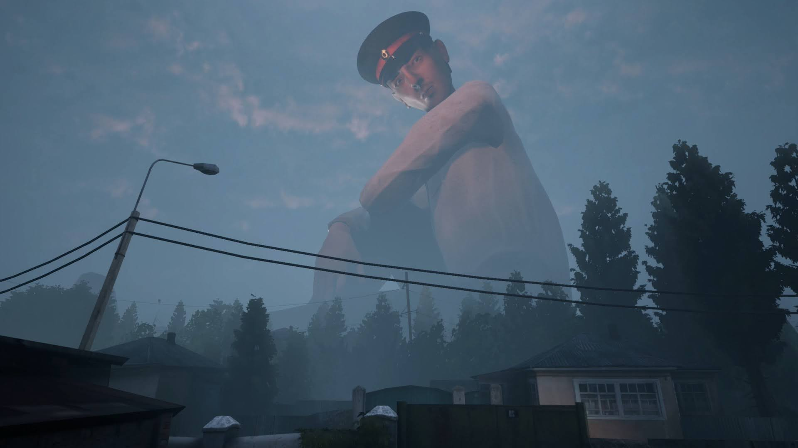

- ### Momo pixel
- Hair Nah is a travel game about a Black woman tired of people touching her hair. The arcade game uses motion-sensing technology to track body movements, rather than requiring the player to use traditional game controls. 

I like how we wouldn't expect a game on this topic and to gamify a very real situation.

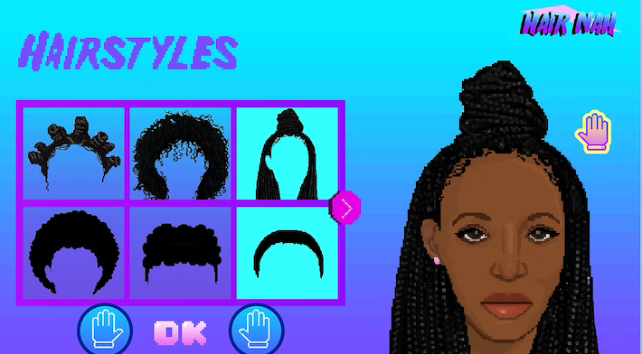

- ### Hypnospace Outlaw
- ethnographic archive of the 1990s "vernacular web": pages created by amateurs
- raises questions that are still relevant today about moderation, censorship, the power of tech companies, and the obsolescence of the web, with the Y2K bug as a backdrop.
- fake operating system, HypnOS, with a desktop, windows, a trash can, wallpapers, and screensavers.
- fake viruses attacking your desktop: windows that open on their own, moving icons, and intrusive mascots.

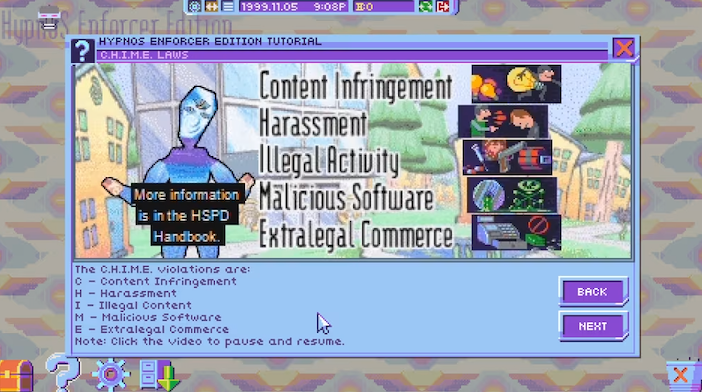

- ### Poco
- Poco is a tiny clown who dreams of joining the giant circus. The jury then opens a trapdoor, and Poco falls into the Below World. It's a vast junkyard where discarded objects and those rejected by the circus end up.
- The true subject of the game is this reunion of siblings, more so than the quest for the rocket.

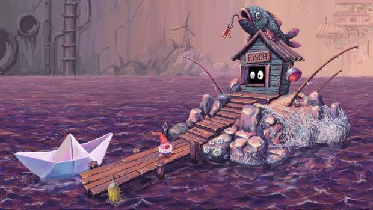
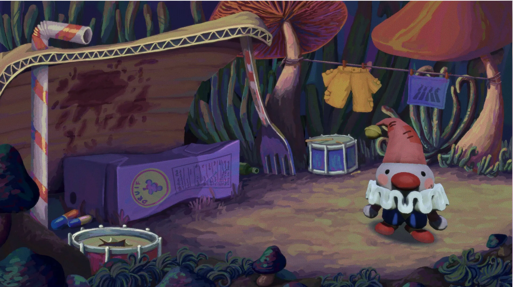

- ### Video Verse
- world : fake 2000s social network that's about to shut down
- theme : toxicity, harassment, and online friendships

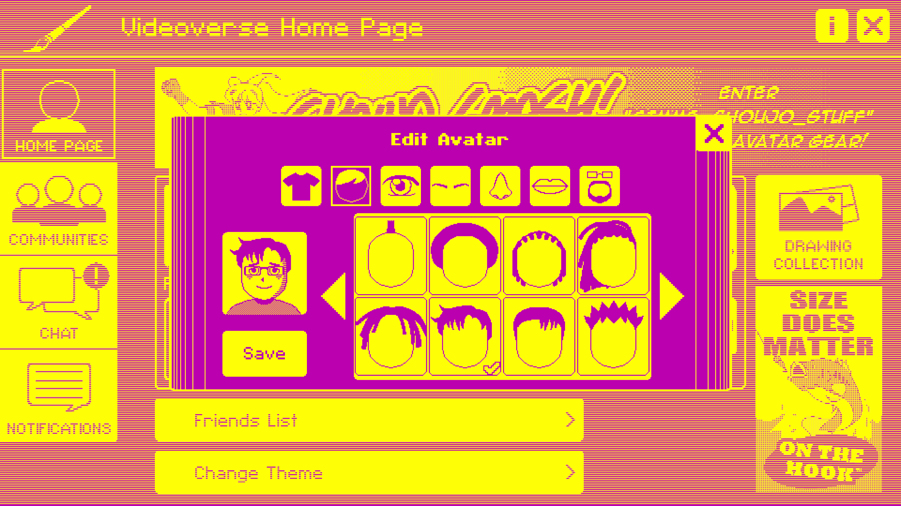
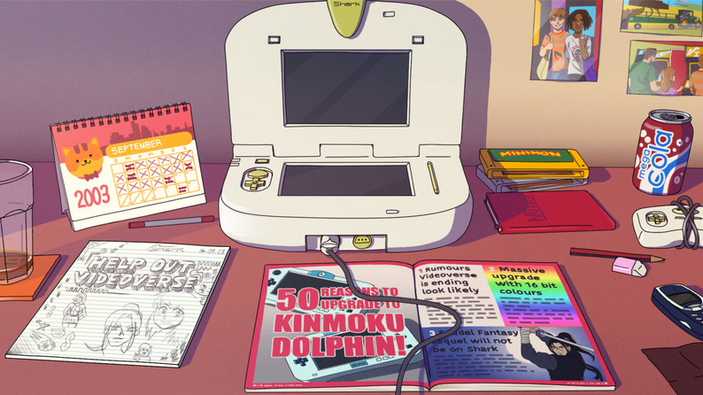

- ### Player Non Player
- world : strange island and meet four enigmatic characters. Interact with them, befriend them, and discover their dreams
- help these characters so they can finally find peace

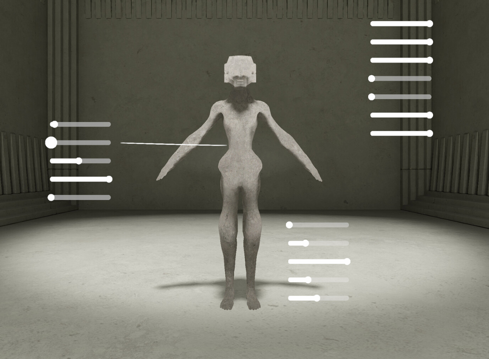
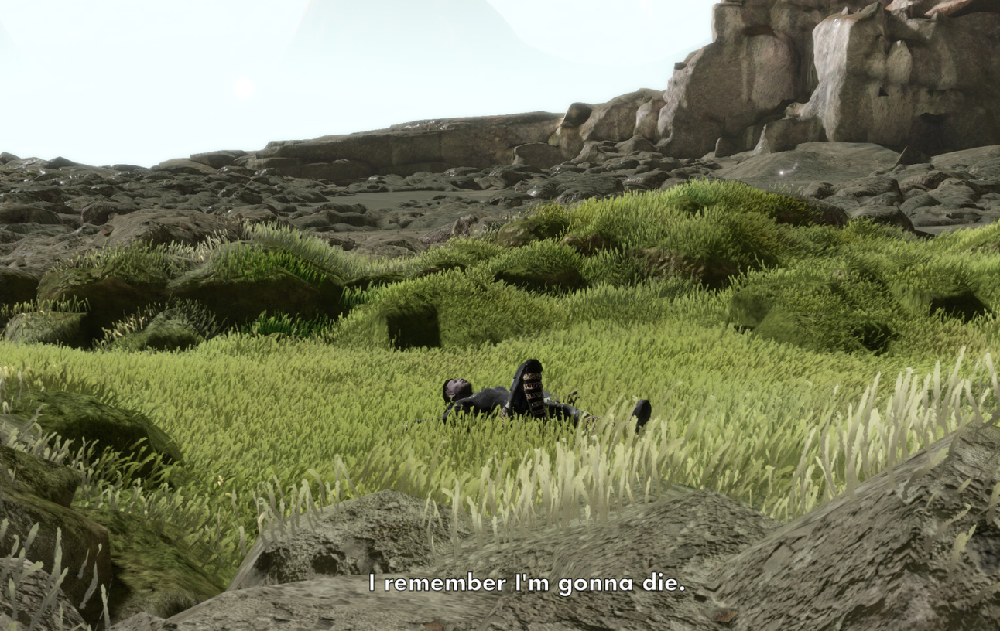

- ### Dys4ia
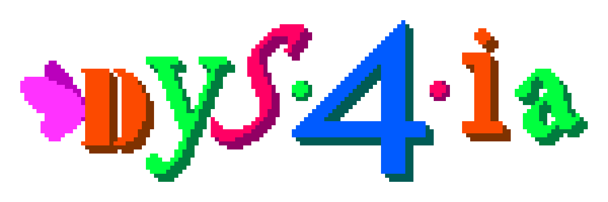
- a series of pixel art mini-games
- about the author's gender transition
- comments, misgendering, and reactions of others
-  short and  striking.

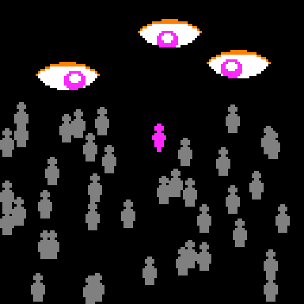

- ### Poney Island
- world : takes you on a fantastical journey through time, blending myths, deities, and video games
- goal: to escape the demons of Hell with your soul… and your wits. This game has absolutely nothing to do with ponies.

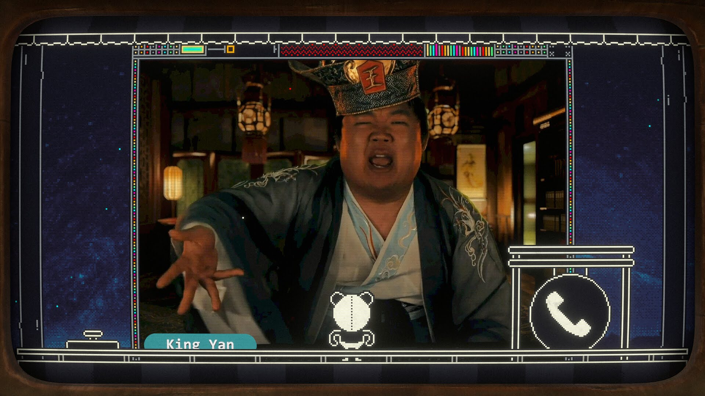